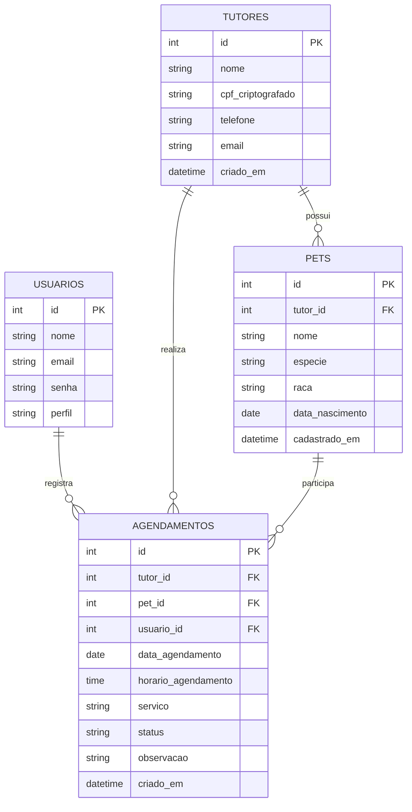

# Sistema de Gestão de Clínica Veterinária

**Estudante:** Daniel de Oliveira Cabral  
**Data:** 12/11/2026

## Projeto

Sistema para organizar os atendimentos de uma clínica veterinária. A aplicação centraliza o cadastro de tutores e pets e o controle de agendamentos, reduzindo perda de consultas e duplicidade de informações.

## Escopo

O sistema contempla autenticação de usuários, consulta e edição de tutores, cadastro de pets vinculados a tutores e consulta e atualização de agendamentos. Os dados são armazenados em banco relacional; apenas o CPF do tutor deve ser mantido criptografado no banco de dados para segurança dos dados pessoais (LGPD). A senha dos usuários não é criptografada.

Não fazem parte do escopo pagamentos, prontuários clínicos completos ou gestão de estoque.

## Requisitos funcionais

1. **RF01 — Acesso ao sistema:** autenticar usuários, informar falhas de login e encerrar a sessão após um período de expiração. Após o acesso, exibir o nome do usuário, os recursos disponíveis e a opção de sair.
2. **RF02 — Tutores:** listar tutores, permitir busca por termo e atualizar a listagem com os resultados encontrados. Permitir editar e salvar os dados de um tutor.
3. **RF03 — Pets:** cadastrar pets e associar cada pet a um tutor existente.
4. **RF04 — Consulta de agendamentos:** listar os agendamentos ordenados por data, exibindo os dados correspondentes do tutor e do pet.
5. **RF05 — Atualização de agendamento:** permitir alterar a data de um agendamento e salvar a alteração.

## Requisitos não funcionais

1. **RNF01 — Segurança e privacidade:** armazenar o CPF do tutor de forma criptografada para proteger dados pessoais sensíveis em conformidade com a LGPD (apenas o CPF é criptografado; a senha do usuário não é criptografada) e proteger o acesso ao sistema por autenticação com tempo de expiração de sessão.
2. **RNF02 — Integridade:** manter os vínculos entre usuários, tutores, pets e agendamentos consistentes no banco de dados.
3. **RNF03 — Manutenibilidade:** organizar o sistema em camadas MVC e manter sua documentação técnica atualizada.

## Arquitetura

A aplicação segue o padrão **MVC (Model-View-Controller)**:

- **Model:** representa os dados e as regras do domínio, como usuários, tutores, pets e agendamentos.
- **View:** apresenta as páginas e formulários da aplicação em HTML e CSS.
- **Controller:** recebe as requisições, aciona as operações necessárias e seleciona a resposta apresentada.

## Tecnologias

- Java 21
- Spring Boot 4.1.2
- PostgreSQL
- HTML e CSS
- Maven

## Diagrama entidade-relacionamento


```